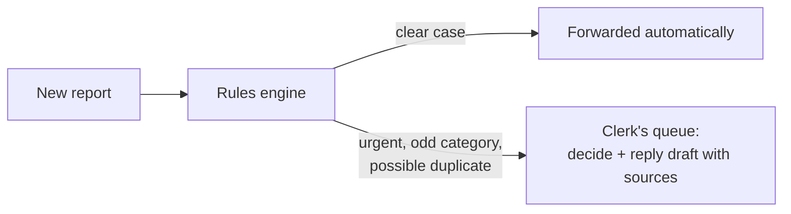

# civic-report-triage

A triage assistant for citizen reports to the city of Köln, built on real data. It imports the reports Köln publishes through its Open311 API, sorts them by urgency with a rules engine, and drafts a reply from the city's own service pages, citing the passages each draft is based on. A person checks every draft; nothing is sent anywhere.

It is a portfolio project: I build it to practise the skills from my professional work end to end and to learn RAG and AI-assisted development. v0.1 is due on 2 Dec 2026.

## Documentation

- [Documentation index](docs/README.md): reading order and glossary
- [Requirements](docs/01-requirements.md): what v0.1 must do
- [Use cases](docs/02-use-cases.md): who uses the app and how
- [Data flow](docs/03-data-flow.md): external systems, their limits, other cities' data
- [Architecture](docs/04-architecture.md): components, data model, repository layout
- [Decisions](docs/decisions/README.md): architecture decision records
- [Working with Claude](docs/working-with-claude.md): how the project is built with AI, and where I overruled it
- [Project management](docs/project-management.md): releases, schedule, time budget
- [Service pages](service-pages/README.md): the public city pages the reply drafts are based on

## The idea

### Goal of the project

I have not built a personal project for a long time. Most of my skills grew inside a company codebase, where much of the setup already existed. This project rebuilds them from an empty repository, end to end, and adds the skills that are in demand now.

**Skills I reuse and want to firm up:**

| Skill | Where it shows in this project |
| --- | --- |
| Rules engines (conditions, actions, priorities, testing rules before they go live) | Triage rules in v0.2, rule tester in v0.6 |
| React and TypeScript | The web app (`apps/web`) |
| Node.js and REST API design | The API server (`apps/api`), Fastify instead of Express |
| PostgreSQL (schema design, indexing, query tuning) | Reports, chunks and import runs; upserts; later the vector index |
| ETL | The Open311 import: fetch in small windows, map, upsert, log each run |
| Unit and integration tests | Vitest, integration tests against the Compose database, a retrieval test set |
| Git, code review, small commits | One issue per branch, one topic per commit, pull requests |
| Docker | Docker Compose locally, production containers |
| CI scripts | GitHub Actions (I used GitLab CI before) |
| Linux servers, logs | The AWS host, structured logs from v0.3 |

**New skills I want to learn here:**

- RAG: embeddings, pgvector, chunking, retrieval, citing sources
- LLM APIs and their failure modes: cost, latency, prompt injection
- Deploying to AWS with CI/CD (EC2, IAM, then Terraform in v0.4)
- AI-assisted development as a professional skill: staying the one who decides, checking every output, keeping comprehension. See [Working with Claude](docs/working-with-claude.md).

**Used on purpose: strategic domain-driven design.** One vocabulary in code, docs and UI, taken from the domain (a report, a service page, an import run; see the [glossary](docs/README.md#glossary)), and the domains as the borders of the code.

**Out of scope on purpose:** Clean Architecture in full, hexagonal architecture, microservices and the tactical patterns of DDD (aggregates, value objects, domain events). I used parts of them at work, and they may get their own project. Here they would add layers without adding value, because the domain logic is thin. Both choices are recorded in [ADR 0003](docs/decisions/0003-code-structure.md).

### From the goal to the idea

The goal set the criteria for what to build. A project idea had to:

1. **run on real data I did not write**, so that the results are tested on input I do not control;
2. **use a rules engine**, the skill I know best and want to lead with;
3. **need RAG**, the main new skill;
4. **contain a real DevOps problem**, because DevOps is the direction I want to grow in.

Four ideas were compared against these criteria in November 2026, before the first line of code:

| Option | Real data I did not write | Rules engine | RAG | DevOps problem | Main risk |
| --- | --- | --- | --- | --- | --- |
| **Civic report triage** (picked) | Yes: Köln's reports, new every day | Yes: urgency, department, response time | Yes: replies from city pages | Yes: an unreliable city API | The knowledge base has to be built from city pages |
| Ops helpdesk assistant (dropped) | No: I would write both the tickets and the runbooks | Yes: ticket routing | Yes: replies from runbooks | Little | Retrieval is never tested on independent data |
| Ask-the-docs assistant | Yes: an open-source documentation set | No | Yes | Little | Very common, so it stands out less |
| Natural-language dashboard | Yes: an open dataset | No | No: generates SQL instead | Little | Safe LLM-generated SQL takes long to get right |

Civic report triage is the only option that meets all four criteria. Two more reasons made it the pick:

- **It relates to my everyday life.** I live in Köln, and the reports are about streets I know: dumped furniture, broken signs, blocked drains.
- **The data is open and anonymised.** Köln publishes it under Datenlizenz Deutschland – Zero 2.0, so no personal or confidential data is involved.

### What already exists

Automatic classification of 311 requests has been studied and built before, mostly on US data: machine-learning classifiers that predict the responsible department (for example on Calgary open data), LLM-based categorisation of request text and images ([smart-311](https://github.com/hersh-gupta/smart-311)), and commercial and municipal deployments. For Köln, the R package [r311](https://github.com/ropengov/r311) gives access to the same Open311 data. This project differs in scope rather than in the classification idea: deterministic rules before the LLM, reply drafts grounded in cited city sources, German-language data, and a deployed, monitored service rather than a notebook or a model.

### What the app does

Köln publishes the reports it receives (illegal dumping, broken street lights, abandoned vehicles, blocked drains) as anonymised open data through the Open311 GeoReport v2 standard. The app imports these reports into its own database, so it keeps working when the city API is down. A rules engine suggests urgency, department and target response time. A RAG component drafts a reply from the city's own public service pages and shows the passages each draft is based on, so a person can check it against its source. Nothing is sent to citizens or to the city.

How it is used: [Use cases](docs/02-use-cases.md). How it is built: [Architecture](docs/04-architecture.md).

### Product idea and its limits

As it stands, this app does not solve a confirmed problem. To build it for real use, I would first need to know how the city processes reports today, and I cannot see that from open data. The project is a prototype on real data, and its product idea is a hypothesis.

**What the data shows** (Köln, 100 reports from 1–2 Oct 2026, fetched 26 Nov):

- The citizen picks the category in the city's reporting app "Sag's uns". Forwarding a report to the right office by category is a lookup, and the city already does it: 96 of the 100 reports were closed.
- The city's reply to the citizen is not public: the `status_note` field was empty in all 100.
- Urgency is often hidden in the free text, not in the category. A real example: "Vor Kindergarten sehr schief zur Straße geneigtes Verkehrsschild" (a sign tilted badly towards the street in front of a nursery) has the same category as any tilted sign.

**Where I put the value:** automate the clear cases and show a person only what needs judgement.

1. **Triage by urgency** (v0.2): rules flag reports whose text suggests a safety risk, likely duplicates and possibly wrong categories. "Triage" here means sorting by urgency, as in medicine, not forwarding.
2. **Replies grounded in the city's own pages** (v0.1): a draft that answers the citizen with the official information (who is responsible, what happens next), checked by a person before it is used. Other cities publish only short template replies (see [Data flow](docs/03-data-flow.md#other-cities)), so this is where an assistant could add something.

**If routing is automated:** the app stays useful, because its value is in the exceptions and the reply, not in the forwarding. The clear cases go straight to the department; the clerk's list shrinks to the reports that need a person (management by exception):

Forwarding automatically from this app would need write access to the city's internal systems, an audit log and a way to undo a wrong routing. That is out of scope: the app reads a snapshot and never writes back.

**What would have to be true for this to be useful:** someone in a city administration office reads reports and answers citizens by hand, urgent reports get lost among routine ones, and template replies are not enough. The first step of a real project would be talking to the people in the city offices who process the reports.

## Data sources

| Source | API | Licence |
| --- | --- | --- |
| Köln, "Sag's uns" | `https://sags-uns.stadt-koeln.de/georeport/v2/` (Open311 GeoReport v2) | Datenlizenz Deutschland – Zero – Version 2.0 |

The reports are published anonymised by the city. This project stores a snapshot of them and does not write anything back to the city's systems.
