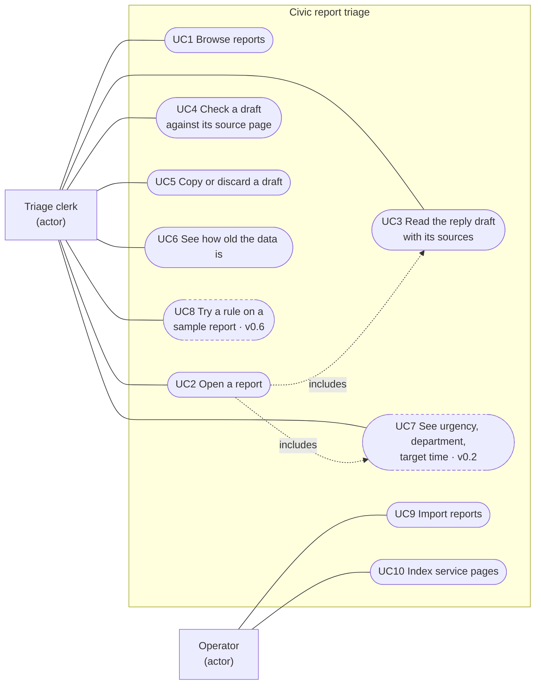

[Project](../README.md) › [Docs](README.md) › 02 Use cases

# 02 Use cases

The app has one main user: a person working in a city administration office who goes through incoming reports, decides what is urgent and answers the citizen. A second, technical role keeps the data current. Both are assumptions for a prototype (see [Product idea and its limits](../README.md#product-idea-and-its-limits)).

## Actors

| Actor | Who | Goal |
| --- | --- | --- |
| Triage clerk | A person in a city administration office who processes citizen reports (hypothetical persona) | See which reports need attention first and answer citizens correctly, with less searching |
| Operator | Whoever runs the app; in v0.1 that is me | Keep reports and city pages current, without the app depending on the city API |
| Citizen | Writes the report in the city's own app "Sag's uns" | Not a user of this app. Never sees a draft. |

## Use-case diagram

Solid use cases are in v0.1; dashed ones come in the release named in the box.

## Use cases

| ID | Use case | Steps | Release |
| --- | --- | --- | --- |
| UC1 | Browse reports | The clerk sees the imported reports, newest first, with category, district, status and date. | v0.1 |
| UC2 | Open a report | The clerk opens one report and sees its text, address, category, photo link and status as Köln published them. | v0.1 |
| UC3 | Read the reply draft | Opening a report shows a draft reply in German. Next to it are the chunks it used, each with the page title and a link. | v0.1 |
| UC4 | Check a draft against its source | The clerk opens a cited page and checks that the draft says what the page says. A draft without sources is marked as such. | v0.1 |
| UC5 | Copy or discard a draft | The clerk copies the draft to use elsewhere, or ignores it. The app sends nothing. | v0.1 |
| UC6 | See how old the data is | Every page shows "data as of" the last successful import, so the clerk knows newer reports may exist. | v0.1 |
| UC7 | See the triage suggestion | A report shows the suggested urgency, department and target response time, with the rule that produced each, and flags such as "possible safety risk". | v0.2 |
| UC8 | Try a rule | A screen runs a rule on a sample report and shows what it would change before the rule goes live. | v0.6 |
| UC9 | Import reports | The operator runs `npm run import-reports` for a date range. A failed run is logged and the previous data stays. Scheduled from v0.5. | v0.1 |
| UC10 | Index service pages | The operator runs `npm run index-service-pages`. Pages in `sources.yaml` are fetched, chunked and embedded. A page that cannot be fetched keeps its last version. | v0.1 |

## Out of scope

- Sending a reply to a citizen, or writing anything back to the city's systems
- Changing a report's status or category
- User accounts and roles (v0.1 is a public read-only demo)
- Reports from other cities (see [ADR 0002](decisions/0002-koeln-only-data-model.md))

---

[← 01 Requirements](01-requirements.md) · [Docs index](README.md) · [03 Data flow →](03-data-flow.md)
