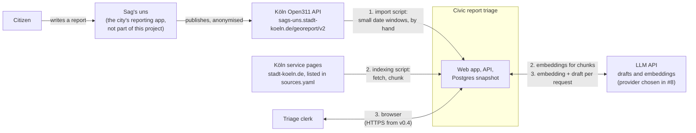

[Project](../README.md) › [Docs](README.md) › 03 Data flow

# 03 Data flow

The app talks to three external systems: the Köln Open311 API for reports, the city's public service pages for reply content, and an LLM API for embeddings and drafts. Only the LLM API is called while a user waits; the city is only contacted by scripts, so a city outage makes the data older but never breaks the app.

This file shows the app as one box. What is inside the box is in [04 Architecture](04-architecture.md).

## System context



| # | Flow | When | Direction | What crosses the boundary |
| --- | --- | --- | --- | --- |
| 1 | Report import | By hand in v0.1, scheduled from v0.5 | Köln → app | Reports for a date window (JSON). Nothing is sent back. |
| 2 | Service page indexing | By hand, when `sources.yaml` changes | City pages → app, app ↔ LLM API | Page HTML in; chunk text out for embeddings, vectors back |
| 3 | Draft request | When the clerk opens a report | Clerk ↔ app ↔ LLM API | Report text and retrieved chunks out to the LLM API; draft back. No personal data: the reports are anonymised by the city. |

## External sources

| Source | Used for | Licence | Called by |
| --- | --- | --- | --- |
| Köln Open311 GeoReport v2 (`requests.json`) | Reports | Datenlizenz Deutschland – Zero – Version 2.0 | Import script only |
| Köln service pages listed in [`service-pages/sources.yaml`](../service-pages/sources.yaml) | Knowledge base for drafts | Recorded per page with each chunk | Indexing script only |
| LLM API | Reply drafts | Provider chosen in #8; paid per token | API server |
| Embedding API | Embeddings for chunks and for the opened report | Provider chosen in #8; paid per token | Indexing script and API server |

## Known constraints of the upstream APIs

| Constraint | Seen | How the app handles it |
| --- | --- | --- |
| Köln times out on large date ranges and sometimes returns a proxy error | Known before the project started (Nov 2026) | Windows of one day to one week, timeout, retry with backoff |
| Results are capped per response | Köln returned exactly 100 records for 1–2 Oct 2026; San Francisco exactly 50 for one day. A round number means there are probably more. | Page through results until a short page comes back (verified in #5) |
| Reports appear only after the city publishes them | A window for 20 Nov 2026 returned 0 records on 26 Nov | Re-import recent windows; upsert makes repeats safe |
| Field contents are city-specific (categories, address format) | See [other cities](#other-cities) | The Köln adapter maps them to the app's report schema |
| City pages change or disappear | Expected | A page that cannot be fetched keeps its last stored chunks; every chunk stores its fetch time |

The 20 Nov result can also mean the date format with a time part is not accepted; #5 checks both.

## Köln data structure

One real record from the Köln API (fetched 26 Nov 2026, shortened `media_url`):

```json
{
  "service_request_id": "23648-2026",
  "title": "#23648-2026 Defekte Verkehrszeichen",
  "description": "Pesch: Vor Kindergarten sehr schief zur Straße geneigtes Verkehrsschild. Bitte richten!",
  "lat": 51.00081334445,
  "long": 6.8763470649719,
  "address_string": "50767 Köln - Pesch, Offenbachstr. 24",
  "service_name": "Defekte Verkehrszeichen",
  "service_code": "2.4.2",
  "requested_datetime": "2026-10-01T00:26:40+02:00",
  "updated_datetime": "2026-11-02T15:27:02+01:00",
  "status": "closed",
  "status_note": "",
  "media_url": "https://sags-uns.stadt-koeln.de/system/files/2026-10/…png"
}
```

What this means for the app:

- `service_request_id` is a string with the year ("23648-2026"), unique within Köln. It is the upsert key.
- There is **no district field**. The district (Stadtteil) is inside `address_string` after "Köln - ", so the adapter parses it.
- `service_name` is the category the citizen picked. The most common in 100 reports: Wilder Müll (28), Defekte Oberfläche (15), Schrott-Kfz (10), Gully verstopft (7), Straßenbaustellen (7). `service_code` ("2.4.2") is a stable code next to the name.
- `status` is only `open` or `closed`, and `status_note` was empty in all 100 records.
- The whole record is also stored as `raw` (jsonb), so a mapping bug can be fixed without fetching again.

## Other cities

The app is Köln only ([ADR 0002](decisions/0002-koeln-only-data-model.md)), but the design should not make a second city expensive. To see what "another city" really means, I fetched two days of reports from two other Open311 cities on 27 Nov 2026: Zürich ("Züri wie neu", 93 reports for 1–3 Oct) and San Francisco (50 reports for 1 Oct).

All three follow GeoReport v2, and all three differ:

| Field | Köln | Zürich | San Francisco |
| --- | --- | --- | --- |
| Response shape | JSON array | Object: `{"service_requests": [...]}` | JSON array |
| Extra query parameter | none | `jurisdiction_id=zurich` required | none |
| `service_request_id` | String with year: `"23648-2026"` | Number: `87461` | String: `"202000124938"` |
| `lat` / `long` | Numbers | Strings: `"47.387293"` | Numbers |
| Address | `address_string`: `"50767 Köln - Pesch, Offenbachstr. 24"` | None, only coordinates | `address`: `"428 3rd St"` |
| District | Inside the address | Not provided | Not provided |
| Category | German name + numeric code: `"Defekte Verkehrszeichen"`, `"2.4.2"` | German name, code = name: `"Beleuchtung/Uhren"` | English name + path code: `"Blocked pedestrian walkway"`, `"PW:BSM:Blocked Street and Sidewalk"` |
| Text | `description` | `title`, `detail`, and `description` = title + detail | `description` |
| City's reply | `status_note`, empty in all 100 | `service_notice`, a template in all 93 | `status_notes`, short canned text |
| Extra fields | `title` | `agency_sent_datetime`, `interface_used` | `token` |

The replies are worth a closer look, because they are what the drafter competes with:

- **Zürich** uses one template with two endings: "Besten Dank für Ihre Meldung auf «Züri wie neu». Die von Ihnen gemeldete Störung ist in Bearbeitung" (is being handled) or "… wurde behoben" (has been fixed).
- **San Francisco** uses short status phrases: "Case Resolved.", "Administrative Closure. If issue persists, please resubmit request.", and "Case Transferred. Your request falls under the responsibility of The United States Postal Service (USPS)…". The last one shows that forwarding to the right body does happen, and it is the city that records it.

### How another city would be integrated

Each city gets an adapter that maps its records to the same report schema:

| Report field | Köln | Zürich | San Francisco |
| --- | --- | --- | --- |
| `service_request_id` | `service_request_id` | `String(service_request_id)` | `service_request_id` |
| `service_name` | `service_name` | `service_name` | `service_name` |
| `description` | `description` | `detail` (avoids the duplicated title) | `description` |
| `address` | `address_string` | none | `address` |
| `district` | parsed from `address_string` | none (could come from coordinates) | none |
| `lat`, `lon` | `lat`, `long` | `Number(lat)`, `Number(long)` | `lat`, `long` |
| `status` | `status` | `status` | `status` |
| `raw` | whole record | whole record | whole record |

### Impact on the architecture

What a second city would change, from cheap to expensive:

| Change | Cost | Prepared today by |
| --- | --- | --- |
| A new adapter (shape, types, field names) | Small: one module and its tests | The Open311 interface with one adapter per city (CLAUDE.md rule) |
| A `city` column and unique key `(city, service_request_id)` | One migration: existing rows are all Köln | `source` already stored on every row ([ADR 0002](decisions/0002-koeln-only-data-model.md)) |
| Its own import schedule and windows per city | Small | Import runs are logged per run |
| Category mapping: rules and `sources.yaml` are keyed by Köln category names | Medium: every rule and page entry needs a mapping per city | Nothing yet; decide when a second city is planned |
| A knowledge base per city, possibly in another language (English for San Francisco; Swiss spelling "Strasse" for Zürich) | Large: new pages, a multilingual embedding model check, a new retrieval test set | The retrieval test set (#15) shows how to measure it |
| Licence per city | Small, but must be checked before importing | `licence` stored on every row |

The column is the cheap part. Categories and the knowledge base are the real work of a second city, and building them before a city is chosen would mean guessing.

---

[← 02 Use cases](02-use-cases.md) · [Docs index](README.md) · [04 Architecture →](04-architecture.md)
