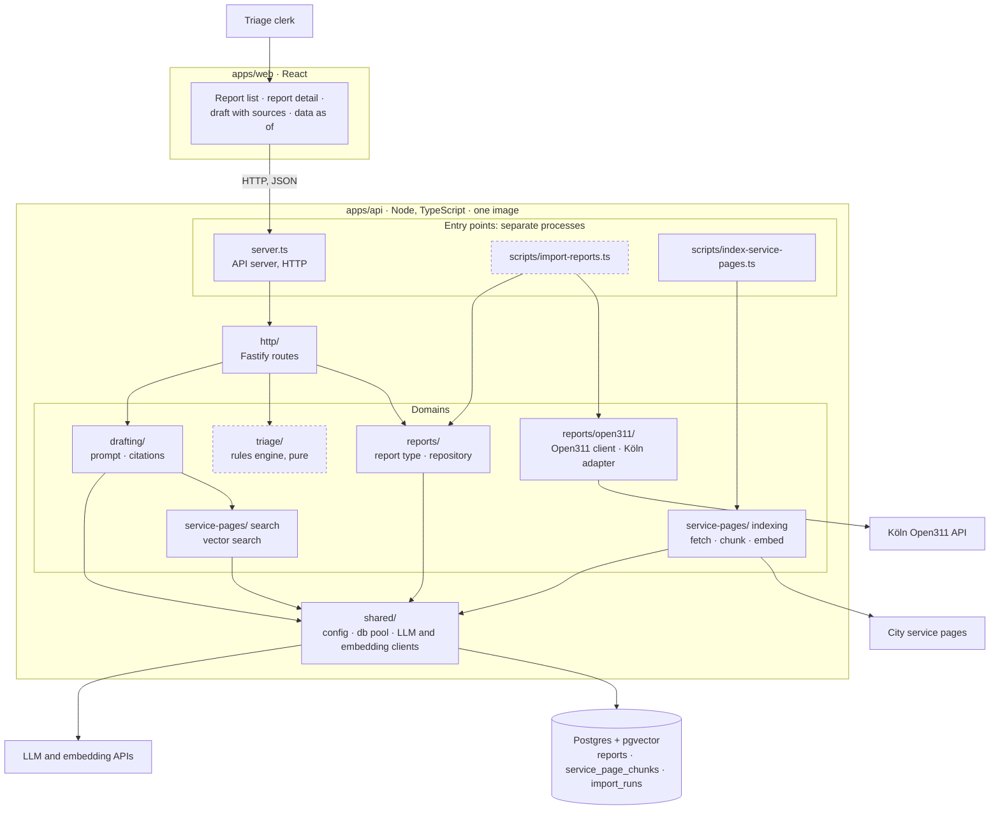

[Project](../README.md) › [Docs](README.md) › 04 Architecture

# 04 Architecture

The app is three containers: a React web app, one Node/TypeScript backend and Postgres with pgvector. The backend is one codebase (`apps/api`) with three entry points: the API server, which only reads from Postgres, and two scripts that fill it. Inside, the code is split by domain: reports, service pages, triage and drafting.

## Technology

React, Node.js 24 with TypeScript and Fastify, Postgres 16 with pgvector, `node-pg-migrate` for migrations, Vitest, Docker Compose locally, GitHub Actions for CI, AWS for deployment (Terraform from v0.4). Plain LLM SDKs, no LangChain.

## Component view

Boxes are grouped by where their code lives; an arrow means "uses". Dashed boxes are minimal in v0.1: the rules engine passes reports through, and the import script is started by hand until v0.5.



Two rules are visible in the diagram:

- **No city API during a request.** The HTTP routes have no path to the Open311 client or the page fetcher; only the scripts do.
- **Domains meet only through exported functions.** Drafting uses the `service-pages` search; it does not read the chunk table itself.

## Components

| Component | Folder | Does | Release |
| --- | --- | --- | --- |
| Web app | `apps/web` | Lists reports, shows one report with its draft and sources, shows "data as of". Talks only to the API server. | v0.1 |
| API server | `apps/api/src/server.ts`, `http/` | Single entry point for the web app. Reads reports from Postgres, runs triage and the drafter. | v0.1 |
| Reports | `apps/api/src/reports/` | Report type, repository (upsert, list, read), import use case | v0.1 |
| Open311 client | `apps/api/src/reports/open311/` | Interface plus the Köln adapter: small date windows, paging, timeout, retry with backoff. Tests use a fake. | v0.1 |
| Service pages | `apps/api/src/service-pages/` | Indexes the pages in `sources.yaml` (fetch, extract the main text, chunk, embed); vector search filtered by category. For the drafter these chunks are the knowledge base. | v0.1 |
| Triage | `apps/api/src/triage/` | Rules engine: report in, urgency, department, target time and flags out. A pure function. Pass-through in v0.1. | v0.2 |
| Drafting | `apps/api/src/drafting/` | Embeds the report text, retrieves chunks, builds the prompt with the chunks as the only source, returns the draft and its citations. Treats report and page text as untrusted. | v0.1 |
| Shared | `apps/api/src/shared/` | Config (validated with zod), database pool, LLM and embedding clients | v0.1 |
| Import script | `apps/api/src/scripts/import-reports.ts` | `npm run import-reports -- --from 2026-11-01 --to 2026-11-08`; logs an import run | v0.1, scheduled in v0.5 |
| Indexing script | `apps/api/src/scripts/index-service-pages.ts` | `npm run index-service-pages`; a page that cannot be fetched keeps its last chunks | v0.1 |
| Postgres + pgvector | `db/migrations/`, `docker-compose.yml` | Reports, chunks with embeddings, import runs | v0.1 |

The folders inside `apps/api/src` are the target structure from [ADR 0003](decisions/0003-code-structure.md). Today only `app.ts`, `config.ts`, `server.ts` and `routes/health.ts` exist; they move into place when the first domain code lands.

## What happens when a report is opened

1. The web app asks the API server for the report's draft (endpoint defined in #13).
2. The API server reads the report from Postgres.
3. Triage runs on it (pass-through in v0.1).
4. The drafter embeds the report text (one call to the embedding API) and finds the closest chunks with pgvector, filtered by the report's category.
5. The drafter asks the LLM for a reply that uses only those chunks, and checks that the cited chunks are among the retrieved ones.
6. The web app shows the draft next to its chunks, each with a link to the page.

If the import has not run for a while, steps 2–6 still work on the last snapshot; the UI shows its age.

## Data model

`reports` and `import_runs` are created in issue #3; `service_page_chunks` in #9, once the embedding model and its vector dimension are chosen in #8. Köln only, so no `city` column ([ADR 0002](decisions/0002-koeln-only-data-model.md)). Field names from Köln are in [03 Data flow](03-data-flow.md#köln-data-structure).

**`reports`**: one row per Köln report, written by the import script.

| Column | Type | Why |
| --- | --- | --- |
| `id` | `bigint` identity, primary key | The app's own key |
| `service_request_id` | `text`, unique | Köln's id; the upsert key, so a re-import updates instead of duplicating |
| `service_code`, `service_name` | `text` | Category code and name; used by triage and to filter chunks |
| `description` | `text`, null | The citizen's text; untrusted input |
| `address`, `district` | `text`, null | District parsed from Köln's `address_string` |
| `lat`, `lon` | `double precision`, null | Map and duplicate detection later |
| `status` | `text` | `open` or `closed`, as Köln publishes it |
| `requested_at`, `updated_at` | `timestamptz` | Open311 timestamps |
| `media_url` | `text`, null | Link to the photo, if any |
| `raw` | `jsonb` | The whole original record |
| `source`, `licence`, `fetched_at` | `text`, `text`, `timestamptz` | Provenance on every row |

**`service_page_chunks`**: one row per chunk of a listed service page, written by the indexing script. `id`, `url`, `chunk_index`, `categories text[]`, `text`, `embedding vector(n)`, `source`, `licence`, `fetched_at`; unique on `(url, chunk_index)`. The dimension `n` depends on the embedding model, which is chosen in #8. No vector index yet; one is added in #11 when there is data to measure.

**`import_runs`**: one row per import run. `id`, `started_at`, `finished_at`, `window_start`, `window_end`, `status` (`running`, `succeeded`, `failed`), `reports_fetched`, `reports_upserted`, `error`. The `finished_at` of the last successful run is the "data as of" time.

## Repository layout

A monorepo with one folder per deployable app and top-level folders for service pages, schema and infrastructure.

```text
civic-report-triage/
├─ apps/api/            Backend: API server, import and indexing scripts, domains
├─ apps/web/            React web app
├─ service-pages/       sources.yaml: the public city pages the drafter may use
├─ data/                Local caches of API snapshots and fetched pages (not committed)
├─ db/migrations/       Postgres + pgvector schema migrations
├─ docs/                This documentation, decisions/ (ADRs)
├─ infra/               Deploy notes now, Terraform from v0.4
├─ .github/workflows/   CI/CD on GitHub Actions
├─ docker-compose.yml   Local stack: web, api, Postgres + pgvector
└─ CLAUDE.md, README.md, CHANGELOG.md
```

## How the layout maps to the architecture

| Component | Location | Notes |
| --- | --- | --- |
| Web app | `apps/web/` | Separate container; talks only to the API server |
| API server | `apps/api/` | Single entry point for the web app |
| Triage, drafting | `apps/api/` (modules) | Run in-process in the API server |
| Report import | `apps/api/` (separate entry point) | A script; never runs during a request |
| Service page indexing | `apps/api/` (separate entry point) | A script, reusing the chunk, embedding and database code of the drafter |
| Postgres + pgvector | `db/migrations/`, `docker-compose.yml` | Migrations live outside the apps because the schema is shared by the API server and both scripts |
| Service page list | `service-pages/` | Content, not code; can be reviewed without touching the apps |
| Deployment | `infra/`, `.github/workflows/` | Docker containers on AWS, deployed by CI/CD |

Why the scripts share a codebase with the API server, and when that changes: [ADR 0001](decisions/0001-backend-boundary.md).

---

[← 03 Data flow](03-data-flow.md) · [Docs index](README.md) · [Decisions →](decisions/README.md)
