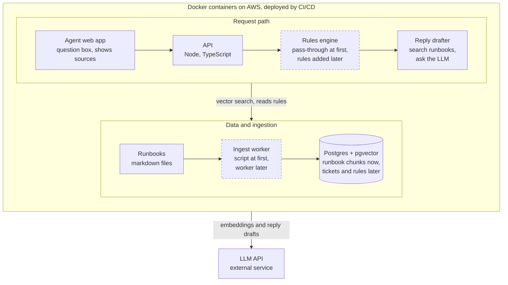

# Ops helpdesk assistant: design overview

## Overview

The project is a helpdesk assistant for IT operations. A small rules engine sorts incoming questions (later, tickets) by category, priority and queue, and a retrieval-augmented generation (RAG) component drafts replies from a library of markdown runbooks. Every reply lists the runbook passages it is based on, so the answer can be checked against its source.

## Options considered

Three project ideas were compared before the design was settled.

| Option | What it is | Technical focus | Main risk |
| --- | --- | --- | --- |
| Ops helpdesk assistant (chosen) | Rules route and prioritise tickets, RAG drafts replies from runbooks | Rules engine, Node/TypeScript API, Postgres, Docker, embeddings, vector search, LLM calls, answer evaluation | Scope creep in the rules part |
| Ask-the-docs assistant | RAG chat over one open-source documentation set | API, React, Postgres, the same RAG components | A very common use case, so it is less distinctive |
| Natural-language dashboard | Plain-language questions become SQL and charts on an open dataset | Dashboards, SQL, indexing, LLM-generated SQL with read-only guardrails | SQL safety takes time to get right |

**Why the ops helpdesk assistant was chosen:**

- Rules and RAG complement each other. Rules give predictable, auditable and cheap routing before the LLM is involved, and the LLM is limited to drafting replies from retrieved runbooks.
- The knowledge base consists of about 15 short, self-written runbooks on common problems such as a full disk, a slow Postgres query or a failing nginx configuration. No proprietary or customer data is involved.
- The project covers the whole path from ingestion to a deployed, monitored service: embeddings and vector search, an API, a web UI, CI/CD and infrastructure as code.

## Architecture

The system consists of a web app, an API, a reply drafter and Postgres with pgvector, all running as Docker containers on AWS and deployed by CI/CD. A rules engine sits between the API and the reply drafter, and an ingest component loads the runbooks into the database. An external LLM API provides embeddings and reply drafts.

Solid boxes are part of the first release. Dashed boxes are stubbed or scripted in the first release and completed in later releases.



### Components

- **Agent web app.** A React page with a question box that shows each answer together with its sources.
- **API.** A Node/TypeScript service that acts as the single entry point for the web app.
- **Rules engine.** Applies JSON rules for category, priority, SLA and queue to an incoming ticket before a reply is drafted. In the first release it passes requests through unchanged.
- **Reply drafter.** Searches the runbook chunks by vector similarity and asks the LLM for a reply, with the retrieved passages as the only source material. User input and retrieved text are treated as untrusted data.
- **Ingest.** Splits the runbooks into chunks, creates embeddings through the LLM API and stores them in Postgres. It starts as a script and later becomes a background worker fed by a queue.
- **Postgres + pgvector.** Holds the runbook chunks with their embeddings. Tickets and rules are added to the same database later.
- **Runbooks.** Markdown files with front matter (title, category, keywords, last reviewed) and sections for symptoms, quick checks, fix, verification and escalation. The commands in the runbooks are examples and are not tested against every environment.
- **LLM API.** An external service used for both embeddings and reply drafts.

### Request flow

A question (later a ticket) enters through the web app and reaches the API. The rules step classifies it, and the reply drafter searches the runbook chunks in Postgres, passes the best matches to the LLM and returns a reply with its sources. The ingest component works independently of requests and keeps the stored chunks in sync with the runbook files.

### Technology

React, Node/TypeScript, Postgres with pgvector, Docker Compose for local development, CI on GitHub Actions, and Terraform with AWS for deployment.

## Repository layout

The repository is a monorepo with one directory per deployable app and top-level directories for content, schema and infrastructure.

```text
ops-helpdesk-assistant/
├─ apps/api/            Node/TypeScript API: rules engine, reply drafter and ingest code
├─ apps/web/            React agent web app
├─ runbooks/            Markdown runbooks (the knowledge base)
├─ db/migrations/       Postgres + pgvector schema migrations
├─ docs/                DESIGN.md, DEMO.md
├─ infra/               Deploy notes now, Terraform later
├─ .github/workflows/   CI/CD on GitHub Actions
├─ docker-compose.yml   Local stack: web, api, Postgres + pgvector
├─ CLAUDE.md, README.md, CHANGELOG.md
```

### How the layout maps to the architecture

| Component | Location | Notes |
| --- | --- | --- |
| Agent web app | `apps/web/` | Separate container; talks only to the API. |
| API | `apps/api/` | Single entry point for the web app. |
| Rules engine | `apps/api/` (module) | Runs in-process between the API and the reply drafter, so it is a module, not an app. Its JSON rules live with the code until they move into Postgres. |
| Reply drafter | `apps/api/` (module) | Runs in-process; shares the database and LLM clients with ingest. |
| Ingest | `apps/api/` (separate entry point) | A script run against the API's code (for example `npm run ingest`), reusing the same chunking, embedding and database code as the drafter. |
| Postgres + pgvector | `db/migrations/`, `docker-compose.yml` | Migrations are kept outside the apps because the schema is shared by the API and ingest. |
| Runbooks | `runbooks/` | Content, not code; kept at the top level so it can be edited and reviewed without touching the apps. Ingest reads it from a mounted path. |
| Deployment | `infra/`, `.github/workflows/` | Docker containers on AWS, deployed by CI/CD. |

### Why ingest lives in `apps/api` for now

In the first release, ingest is a script. It needs the same embedding client, chunk schema and database access as the reply drafter, so keeping it in `apps/api` avoids a shared package and a second build. It still runs as its own entry point and never during a request, which matches the design: ingest works independently of the request path.

When ingest becomes a queue-fed background worker, it can run in either of two ways:

1. From the same `apps/api` image with a different start command, if its dependencies stay small.
2. As its own app, `apps/worker/`, with the shared code (database access, embeddings, chunk types) moved into `packages/core/`. Do this if the worker needs its own scaling or dependencies, or if a third consumer of that code appears.
