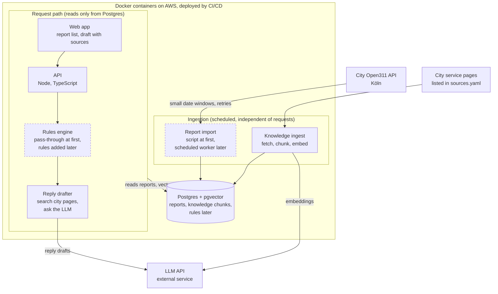

# Civic report triage: design overview

## Overview

The project is a triage service for citizen reports to the city of Köln. Köln publishes the reports it receives (illegal dumping, broken street lights, abandoned vehicles, blocked drains) as anonymised open data through the Open311 GeoReport v2 standard. The service imports these reports, a rules engine assigns each one a department, a priority and a target response time, and a retrieval-augmented generation (RAG) component drafts a reply from the city's own public service pages. Every draft lists the passages it is based on, so it can be checked against its source. Drafts are suggestions for a human; nothing is sent to citizens or to the city.

**Why civic report triage was chosen:**

- The incoming items are real, in German, and change every day, so routing and drafting are tested on data nobody wrote for the project.
- Rules and RAG complement each other. Rules give predictable, auditable and cheap routing before the LLM is involved, and the LLM is limited to drafting replies from retrieved city pages.
- The data is open and anonymised (Köln: Datenlizenz Deutschland – Zero 2.0). No personal or proprietary data is involved.
- The upstream APIs are not always available. Isolating the service from them is part of the design rather than an afterthought.

## Related work

Automatic classification of 311 requests has been studied and built before, mostly on US data: machine-learning classifiers that predict the responsible department (for example on Calgary open data), LLM-based categorisation of request text and images ([smart-311](https://github.com/hersh-gupta/smart-311)), and commercial and municipal deployments. For Köln, the R package [r311](https://github.com/ropengov/r311) provides access to the same Open311 data. This project differs in scope rather than in the classification idea: deterministic rules before the LLM, reply drafts grounded in cited city sources, German-language data, and a deployed, monitored service rather than a notebook or a model.

## Architecture

The system consists of a web app, an API, a reply drafter and Postgres with pgvector, all running as Docker containers on AWS and deployed by CI/CD. A rules engine sits between the stored reports and the reply drafter. Two ingestion paths fill the database: report import from the Köln Open311 API, and knowledge ingest from the public pages listed in `knowledge/sources.yaml`. An external LLM API provides embeddings and reply drafts.

Solid boxes are part of the first release. Dashed boxes are stubbed or scripted in the first release and completed in later releases.



### Components

- **Web app.** A React page that lists imported reports with their category, district and status, and shows a reply draft with its sources for a selected report. It shows the time of the last successful import ("data as of").
- **API.** A Node/TypeScript service that acts as the single entry point for the web app. It reads only from Postgres and never calls a city API during a request.
- **Report import.** A Köln adapter behind an Open311 interface, so tests can use a fake. It queries `requests.json` in small date windows (one day to one week), pages through the results, applies timeouts and retries with backoff, and upserts reports by city and `service_request_id`, so repeated runs are safe. Each report keeps its source, licence and fetch time. It starts as a script and later becomes a scheduled worker.
- **Rules engine.** Applies JSON rules to a report: Open311 category to department, priority (for example higher for safety-related categories), target response time, and flags such as possible duplicates nearby. In the first release it passes reports through unchanged.
- **Reply drafter.** Searches the knowledge chunks by vector similarity, filtered by category, and asks the LLM for a reply with the retrieved passages as the only source material. Report text and retrieved pages are treated as untrusted data.
- **Knowledge ingest.** Fetches the pages listed in `knowledge/sources.yaml`, extracts the main text, splits it into chunks, creates embeddings through the LLM API and stores them with the source URL and fetch time. A page that cannot be fetched keeps its last stored version.
- **Postgres + pgvector.** Holds reports, knowledge chunks with embeddings, and later rules and import run logs.
- **LLM API.** An external service used for both embeddings and reply drafts.

### Data flow

Ingestion and requests are separate. On a schedule (in the first release, by hand), the report import fetches new and updated reports from the Köln API and stores them in Postgres, and the knowledge ingest keeps the stored chunks in sync with the listed pages. When a user opens a report, the API reads it from Postgres, the rules step classifies it, and the reply drafter searches the knowledge chunks, passes the best matches to the LLM and returns a draft with its sources.

If a city API is unavailable, the import run fails, is logged and is retried on the next run. The web app keeps working with the last stored snapshot and shows its age.

### Known constraints of the upstream APIs

- The Köln endpoint times out on large date ranges and occasionally returns a proxy error from its backend. Small windows and retries avoid most failures.
- Results are paginated (50 requests per page in Köln).
- Field contents are city-specific, for example category names and address formats. The Köln adapter maps them to the report schema the rest of the app uses.
- Reports appear in the API only after the city has published them, so the newest reports may be missing for a while.

### Technology

React, Node/TypeScript, Postgres with pgvector, Docker Compose for local development, CI on GitHub Actions, and Terraform with AWS for deployment.

## Repository layout

The repository is a monorepo with one directory per deployable app and top-level directories for knowledge sources, schema and infrastructure.

```text
civic-report-triage/
├─ apps/api/            Node/TypeScript API: rules engine, reply drafter, import and ingest code
├─ apps/web/            React web app
├─ knowledge/           sources.yaml: the public pages the drafter may use
├─ data/                Local caches of API snapshots and fetched pages (not committed)
├─ db/migrations/       Postgres + pgvector schema migrations
├─ docs/                DESIGN.md, DEMO.md
├─ infra/               Deploy notes now, Terraform later
├─ .github/workflows/   CI/CD on GitHub Actions
├─ docker-compose.yml   Local stack: web, api, Postgres + pgvector
├─ CLAUDE.md, README.md, CHANGELOG.md
```

### How the layout maps to the architecture

| Component | Location | Notes |
| --- | --- | --- |
| Web app | `apps/web/` | Separate container; talks only to the API. |
| API | `apps/api/` | Single entry point for the web app. |
| Rules engine | `apps/api/` (module) | Runs in-process between the stored report and the reply drafter. Its JSON rules live with the code until they move into Postgres. |
| Reply drafter | `apps/api/` (module) | Runs in-process; shares the database and LLM clients with ingest. |
| Report import | `apps/api/` (separate entry point) | A script such as `npm run import-reports -- --city koeln --from 2026-11-01 --to 2026-11-08`; never runs during a request. |
| Knowledge ingest | `apps/api/` (separate entry point) | A script such as `npm run ingest-knowledge`, reusing the chunking, embedding and database code of the drafter. |
| Postgres + pgvector | `db/migrations/`, `docker-compose.yml` | Migrations are kept outside the apps because the schema is shared by the API and both ingestion paths. |
| Knowledge sources | `knowledge/` | Content, not code; can be reviewed without touching the apps. |
| Deployment | `infra/`, `.github/workflows/` | Docker containers on AWS, deployed by CI/CD. |

### Why import and ingest live in `apps/api` for now

In the first release, both ingestion paths are scripts. They need the same database access and, for knowledge ingest, the same embedding client and chunk schema as the reply drafter, so keeping them in `apps/api` avoids a shared package and a second build. They still run as their own entry points and never during a request.

When import becomes a scheduled worker, it can run in either of two ways:

1. From the same `apps/api` image with a different start command, if its dependencies stay small.
2. As its own app, `apps/worker/`, with the shared code (database access, embeddings, report and chunk types) moved into `packages/core/`. This fits if the worker needs its own scaling or dependencies, or if a third consumer of that code appears.
