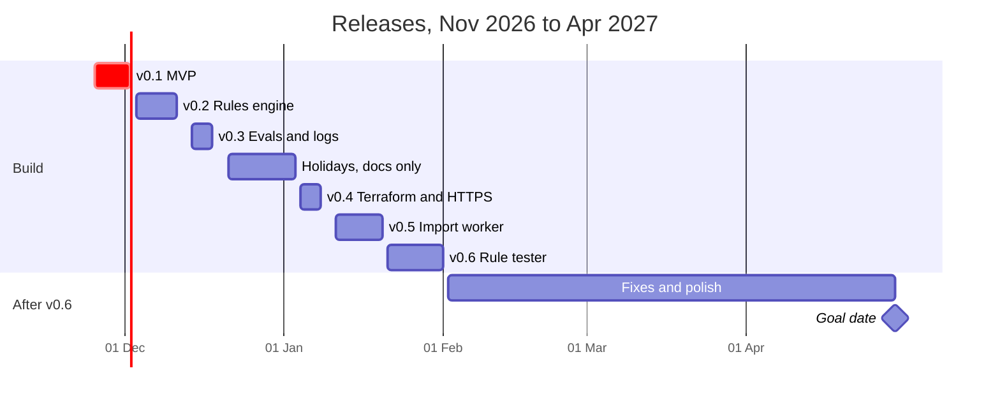

[Project](../README.md) › [Docs](README.md) › Project management

# Project management

v0.1 goes live on 2 Dec 2026, then one release at a time until the goal date of 30 Apr 2027. Each release is small, deployed and documented, so the project is in a reviewable state on any day.

## Goal and deadline

| | |
| --- | --- |
| Goal | A deployed, documented project that shows full-stack and DevOps skills plus RAG ([project goal](../README.md#goal-of-the-project)) |
| v0.1 MVP | 2 Dec 2026: real Köln reports, a report list, a reply draft with cited city sources, live on AWS |
| Goal date | 30 Apr 2027 |
| Tracking | GitHub milestone per release, one issue per task, one branch and session per issue |

## Releases

| Release | Dates | What it adds | A reviewer can then |
| --- | --- | --- | --- |
| v0.1 MVP | 25 Nov – 2 Dec | Import of one month of Köln reports, report list, reply draft with sources, minimal UI, Docker Compose, CI, simple AWS deploy, README with reviewer tour | Open the live URL, pick a report and read its draft |
| v0.2 Rules engine | 3 – 11 Dec | JSON rules per category for department, urgency, target response time and safety flags; rule tests | See reports triaged before a draft is written |
| v0.3 Evals and logs | 14 – 18 Dec | 20+ real reports with expected department and sources run in CI; structured logs; cost per draft | Read the quality score and see how answers are monitored |
| v0.4 Terraform and HTTPS | 4 – 8 Jan | The whole stack as code, HTTPS, budget alert, rebuild in two commands | Inspect the infrastructure and rebuild it |
| v0.5 Import worker | 11 – 20 Jan | Scheduled import with retries and backoff; re-index service pages when they change | See new reports arrive, and the app keep working while the city API is down |
| v0.6 Rule tester | 21 Jan – 1 Feb | A screen to try a rule on a sample report; more prompt-injection checks | Test rules and see the safeguards |

## The v0.1 sprint, planned and actual

The sprint started one working day late (moved on 26 Nov). By the end of 27 Nov it was about one more day behind, because the documentation was split before #3 was finished.

| Day | Planned issues | Actual |
| --- | --- | --- |
| Wed 25 Nov | #1 repo skeleton | Done |
| Thu 26 Nov | #2 API health check, #3 Compose + pgvector, #4 CI | #2 done. #3 planned in depth: domains, data model, real-data check of the product idea |
| Fri 27 Nov | #5 Open311 client, #6 Köln adapter, #7 import script, #8 LLM and embedding clients, #9 service page indexing, #10 sources.yaml, #11 retrieval | Repo renamed; documentation split into this set of files with three ADRs |
| Mon 30 Nov | #12 read endpoints + pass-through rules, #13 draft endpoint, #14 prompt-injection guard, #15 retrieval test set, #16 React UI; open the AWS account with a budget alert | |
| Tue 1 Dec | #17 production containers, #18 AWS EC2 host, #19 deploy workflow | |
| Wed 2 Dec | #20 README tour and demo script, #21 clean-clone check, #22 CHANGELOG and tag v0.1.0 | |

**Recovery plan:** #3 and #4 first thing on Mon 30 Nov, then the import (#5–#7) and the RAG path (#8–#11, #13). If the deploy does not work by Tuesday evening, v0.1 goes on a free app host on Wednesday morning and moves to AWS in v0.4.

## Time budget

| Period | Hours | How |
| --- | --- | --- |
| Until 2 Dec | 7 h a day, Mon – Fri | All of it on the MVP |
| From 3 Dec | About 4 h a day, 20 h a week | Two build blocks of 2 hours (10:30 – 12:30 and 13:30 – 15:30), with a break away from the screen between them |
| 21 Dec – 3 Jan | Reduced | Docs only, no new features |
| Weekends | Off | |

Fridays: the last build block is the release check (docs, changelog, the 3-minute demo).

## How scope is cut

- **The deadline does not move; the scope does.** On a bad day the build block gives up scope, not hours.
- **Releases are cut from the end:** the rule tester (v0.6) first, then the import worker (v0.5). v0.1 to v0.4 are the core.
- **The release checklist is never skipped.**
- **One release at a time:** nothing from v0.2 starts before v0.1 is tagged.

## Release checklist

Every release ends with the same checks:

- [ ] Deployed, and the live URL answers a sample question
- [ ] A git tag and a CHANGELOG entry that says what is new
- [ ] README current: a 60-second reviewer tour (what it is, the live link, three things to try), the architecture diagram, one-command local setup, cost notes, how AI was used
- [ ] A 3-minute demo script that runs end to end on the live site
- [ ] Known issues and the next release listed on the issue board

## Prioritising with the AI

Planning is part of [working with Claude](working-with-claude.md): the AI drafted the issue list and the day plan, and it flags slips (as on 27 Nov). The decisions stay mine: what goes into a release, what is cut, and when the plan changes.

---

[← Working with Claude](working-with-claude.md) · [Docs index](README.md)
